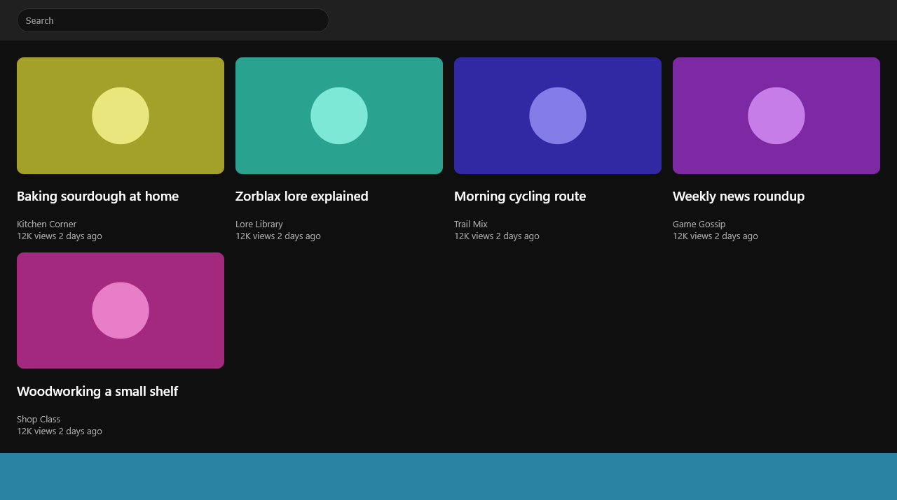
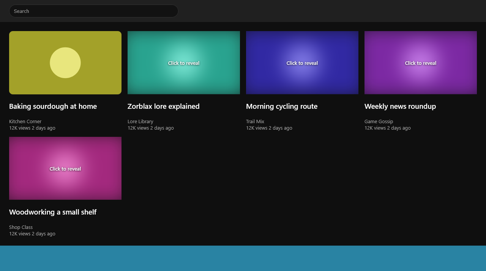
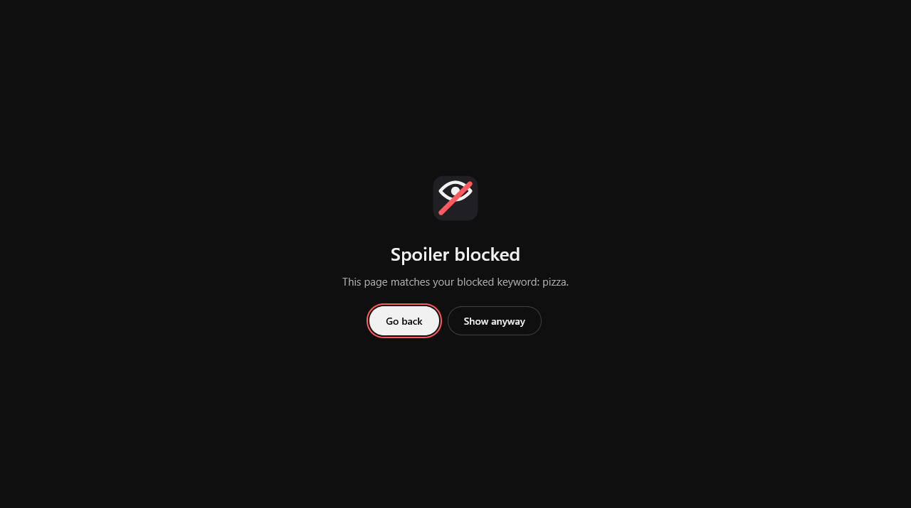
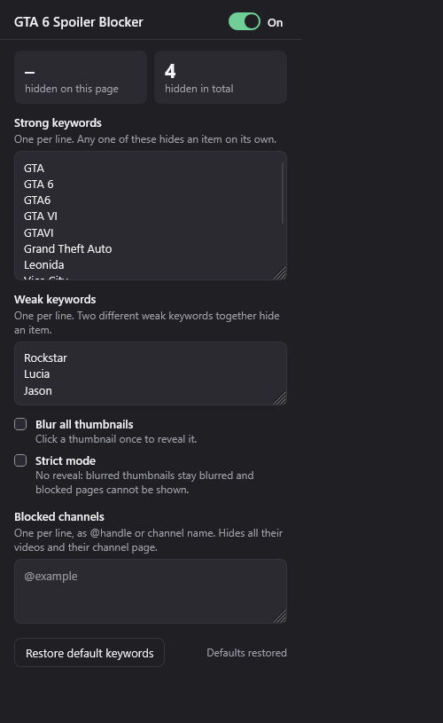

# GTA 6 Spoiler Blocker

[](https://github.com/Db2203/gta6-spoiler-blocker/actions/workflows/ci.yml)
[](LICENSE)


A Firefox extension that keeps GTA 6 off your YouTube feed while you wait for the PC release.

It hides matching videos, Shorts, comments, community posts and search suggestions, blocks matching video pages outright, and can blur every thumbnail until you choose to look. Everything runs locally in your browser: no network requests, no accounts, no data collection.

<p align="center">
  
  
</p>
<p align="center">
  
  
</p>

*Screenshots are taken from the project's own mock pages. The titles are invented.*

## How it works

- **Keyword matching.** Two editable lists. A *strong* keyword hides an item on its own. *Weak* keywords only count when two different ones appear together, which keeps common words like a first name from hiding unrelated videos. Matching is case-insensitive and whole-word, so `GTA` does not match the middle of another word.
- **Fails closed.** Every tile, comment and suggestion is invisible from the moment it enters the page until the extension has checked it. The hiding is done by a stylesheet injected before the page runs, so if the checking code ever crashes, stalls or is out of date, content stays hidden rather than leaking through.
- **Keeps up with YouTube.** Infinite scroll, recycled tiles and in-page navigation are all watched with a mutation observer that decides each item before the browser paints it. 500 tiles inserted at once are decided in about 50 ms.
- **Blocks whole pages.** If you land on a matching video, Short or channel, playback stops, the page is covered and a "Go back" button takes you to where you were. The player stays hidden until the page's own title and description have been checked, so nothing flashes through.
- **Channel blocklist.** Add a handle or channel name and every one of their videos, Shorts, posts and comments disappears, along with their channel page.
- **No hover previews.** Thumbnails never start playing when you mouse over them.
- **Optional thumbnail blur.** Thumbnails can spoil without a single word, so every thumbnail can be blurred. The first click reveals one tile, the second opens it. Strict mode removes the reveal, and removes "Show anyway" from blocked pages.
- **Offline by design.** The only permission beyond youtube.com is local storage for your settings.

Default strong keywords: `GTA`, `GTA 6`, `GTA6`, `GTA VI`, `GTAVI`, `Grand Theft Auto`, `Leonida`, `Vice City`, `Jason Duval`, `Lucia Caminos`.
Default weak keywords: `Rockstar`, `Lucia`, `Jason`.

## Install

The extension is not listed on addons.mozilla.org. There are two ways to run it.

### Permanent install (signed, behaves like any other extension)

Release Firefox only keeps extensions that Mozilla has signed. Mozilla signs self-distributed extensions for free, without listing them, in about a minute:

1. Create a free account at [addons.mozilla.org](https://addons.mozilla.org/) and generate API credentials at [addons.mozilla.org/developers/addon/api/key/](https://addons.mozilla.org/developers/addon/api/key/).
2. In a terminal in this folder, set the two credentials as environment variables and run the sign script. PowerShell:

   ```powershell
   $env:WEB_EXT_API_KEY = "user:12345:678"
   $env:WEB_EXT_API_SECRET = "your-secret"
   npm run sign
   ```

3. A signed `.xpi` appears in `web-ext-artifacts/`. Open it in Firefox (drag it onto a window, or File > Open File) and click **Add**.

The extension now shows up in `about:addons`, survives restarts, and can be disabled or removed like any other. To update it, bump `version` in `extension/manifest.json`, run `npm run sign` again and open the new `.xpi`. Mozilla rejects a re-upload of an already-signed version number.

### Temporary install (no account needed, gone after a restart)

1. Download the zip from the [latest release](https://github.com/Db2203/gta6-spoiler-blocker/releases), or clone this repository.
2. Open `about:debugging#/runtime/this-firefox` in Firefox.
3. Click **Load Temporary Add-on…** and pick the zip, or `extension/manifest.json` from the clone.

Either way, open YouTube afterwards. The toolbar button opens the settings popup. Firefox grants access to youtube.com when the add-on is installed; if you ever revoke it, the popup shows an **Allow on youtube.com** button.

## Settings

Click the toolbar icon to:

- switch the blocker on or off
- edit the strong and weak keyword lists (one per line, saved as you type)
- block channels by `@handle` or display name
- blur all thumbnails, and turn on strict mode
- see how many items were hidden on the current page and in total

## Development

Requirements: Node 22 and Firefox.

```
npm install
npm run test:unit     # keyword matcher, runs in Node
npm run test:e2e      # loads the extension into headless Firefox against local mock pages
npm run lint          # web-ext lint
npm run build         # packages extension/ into web-ext-artifacts/*.zip
npm run sign          # gets the package signed by Mozilla (needs WEB_EXT_API_KEY / WEB_EXT_API_SECRET)
npm run screenshots   # regenerates docs/screenshots from the mock pages
```

The end-to-end tests never touch youtube.com. They serve mock pages from `tests/fixtures/` that copy YouTube's DOM structure with invented content, install a test build of the extension as a temporary add-on, and assert on computed styles. Selenium Manager downloads a matching geckodriver on first run; set `FIREFOX_BIN` if Firefox is installed somewhere unusual, or `SB_HEADED=1` to watch the tests run.

`npm run check:real` drives a signed-out headless Firefox through the real site with the harmless keyword "pizza" and reports structure only (items found, hidden, unchecked, leaked), never page text. The few steps that need a signed-in account are in [docs/manual-testing.md](docs/manual-testing.md).

### Project layout

```
extension/
  manifest.json           Manifest V3, Firefox
  content/hide.css        fail-closed rules, blur, overlay
  content/matcher.js      keyword logic (pure, unit tested)
  content/selectors.js    every YouTube selector in one place
  content/settings.js     defaults and storage
  content/scanner.js      mutation observer, marking, counting
  content/watch-guard.js  blocks matching video, Shorts and channel pages
  content/blur.js         thumbnail blur and click to reveal
  content/main.js         bootstrap
  popup/                  settings UI
tests/
  unit/                   node:test
  e2e/                    selenium-webdriver + headless Firefox, one file per surface
  fixtures/               mock YouTube pages
docs/                     manual test guide, screenshots
```

## Roadmap

- [x] v0.1.0: keyword filtering of video tiles, on/off switch, editable keyword lists, hidden counter
- [x] v0.2.0: Shorts, comments, community posts, search suggestions, end screens, channel blocklist, video page blocking with a "Go back" screen, hover previews off
- [x] v0.3.0: thumbnail blur with click to reveal, strict mode
- [x] v1.0.0: performance guard, packaged build, CI, manual test guide
- [x] Signed build for permanent installation (`npm run sign`)

## Privacy

The extension makes no network requests and collects nothing. Keyword lists and counters are stored with `browser.storage.local` and never leave your machine.

## License

[MIT](LICENSE)
